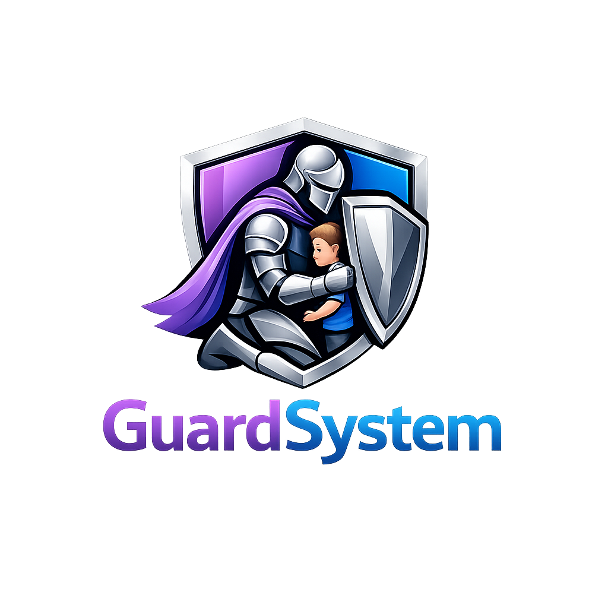

<div align="center">



# 🛡️ GuardSystem

**Sistema de registro e gerenciamento de ocorrências para Conselhos Tutelares**

Sistema web completo para cadastro de conselheiros, autenticação por CPF e registro de ocorrências — com painel administrativo, interface *glassmorphism* e API REST em PHP.

</div>

---

## ✨ Visão Geral

O **GuardSystem** nasce da necessidade de digitalizar o registro de ocorrências de um Conselho Tutelar. A plataforma permite que conselheiros autenticados registrem ocorrências (negligência, evasão escolar, abuso, etc.) com dados de localização e a forma de recebimento da denúncia, além de permitir à equipe administrativa gerenciar os colaboradores do sistema.

O projeto foi construído com **PHP puro (sem frameworks)** no backend, **PostgreSQL** como banco de dados e **JavaScript vanilla** no frontend — uma stack enxuta, leve e fácil de hospedar, com suporte a **Docker** de fábrica.

> 🎨 **Identidade visual:** a interface segue o conceito de *"guardião digital"* — fundo escuro em tons de roxo/azul, efeito *glass* com blur, brilho pulsante no escudo e uma scan-line animada que percorre a tela, remetendo a um HUD de monitoramento de segurança.

---

## 🚀 Funcionalidades

| Área | Recurso |
|------|---------|
| 🔐 **Autenticação** | Login por CPF + senha com verificação segura (`password_verify`) |
| 👥 **Usuários** | Listagem, criação, edição e exclusão de colaboradores |
| 📄 **Ocorrências** | Listagem, criação, edição e exclusão de registros |
| 🧑‍⚖️ **Atribuição** | Cada ocorrência é vinculada ao conselheiro que a registrou (JOIN com nome) |
| ✏️ **Edição** | Formulários pré-preenchidos com os dados atuais do registro |
| 🗑️ **Exclusão segura** | Modal de confirmação antes de excluir qualquer registro |
| 📱 **Máscara de CPF** | Formatação automática `000.000.000-00` durante a digitação |
| 🔔 **Feedback visual** | Notificações *toast* para todas as ações |
| 🌙 **Interface moderna** | Glassmorphism, gradientes, animações e micro-interações |
| ♿ **Acessibilidade** | `focus-visible`, suporte a `prefers-reduced-motion` e layout responsivo |
| 🔒 **Segurança** | Senhas com hash bcrypt e queries com *prepared statements* |

---

## 🧰 Stack Tecnológica

<div align="center">

| Camada | Tecnologia |
|--------|-----------|
| **Backend** | PHP 8.2 (API REST pura) |
| **Banco de dados** | PostgreSQL (via PDO) |
| **Frontend** | HTML5, CSS3 e JavaScript vanilla |
| **Containerização** | Docker + Docker Compose |
| **Fontes** | Rajdhani & Nunito (Google Fonts) |

</div>

---

## 🗂️ Estrutura do Projeto

```
guardsystem/
├── api/                    # Backend — endpoints REST em PHP
│   ├── db.php              # Conexão PDO (PostgreSQL) + CORS
│   ├── login.php           # POST — autenticação de usuários
│   ├── usuarios.php        # CRUD de usuários (GET/POST/PUT/DELETE)
│   └── ocorrencias.php     # CRUD de ocorrências (GET/POST/PUT/DELETE)
│
├── css/
│   └── home.css            # Estilos específicos da tela inicial
│
├── global/
│   ├── global.css          # Design system: tema, componentes e animações
│   └── utils.js            # Utilitários compartilhados (máscara CPF, toast, modal)
│
├── js/                     # Um script por página (frontend vanilla)
│   ├── login.js
│   ├── usuarios.js
│   ├── criar-usuario.js
│   ├── editar-usuario.js
│   ├── ocorrencias.js
│   └── editar-ocorrencia.js
│
├── assets/                 # Imagens (logo do sistema)
│
├── *.html                  # Páginas do sistema (login, home, CRUDs...)
├── guardsystem.sql         # Script de criação das tabelas
├── Dockerfile              # Imagem PHP + PostgreSQL driver
├── docker-compose.yml      # Orquestração do ambiente
└── index.html              # Redireciona para login.html
```

### 🌐 Fluxo de Páginas

```
index.html ──▶ login.html ──▶ home.html ──┬──▶ usuarios.html ──┬──▶ criar-usuario.html
                                          │                    └──▶ editar-usuario.html
                                          └──▶ ocorrencias.html └──▶ editar-ocorrencia.html
```

---

## 📦 Pré-requisitos

- **Docker** + **Docker Compose** *(recomendado)* — ou —
- **PHP 8.2+** com extensão `pdo_pgsql`
- **PostgreSQL** (versão 12 ou superior)

---

## 🚀 Como Executar

### Opção 1 — Docker Compose (recomendada)

```bash
# 1. Clone o repositório
git clone https://github.com/seu-usuario/guardsystem.git
cd guardsystem

# 2. Crie o arquivo de ambiente
cp .env.example .env   # e preencha com os dados do seu banco

# 3. Suba a aplicação
docker-compose up --build
```

Acesse **http://localhost** no navegador. O sistema apontará automaticamente para o banco configurado nas variáveis de ambiente.

### Opção 2 — Execução local (PHP embutido)

```bash
# 1. Configure as variáveis de ambiente do banco
export DB_HOST=localhost
export DB_PORT=5432
export DB_NAME=guardsystem
export DB_USER=postgres
export DB_PASSWORD=sua_senha

# 2. Crie as tabelas no PostgreSQL
psql -U postgres -d guardsystem -f guardsystem.sql

# 3. Inicie o servidor
php -S localhost:80 -t .
```

Acesse **http://localhost** no navegador.

> 💡 **Dica:** use a extensão **Live Server** do VS Code (configurada em `.vscode/settings.json` na porta `5501`) para desenvolver o frontend com *hot reload*.

---

## ⚙️ Variáveis de Ambiente

A conexão com o banco é feita **exclusivamente por variáveis de ambiente** — nenhuma credencial está hardcoded no código.

| Variável | Descrição | Exemplo |
|----------|-----------|---------|
| `DB_HOST` | Host do PostgreSQL | `localhost` |
| `DB_PORT` | Porta do PostgreSQL | `5432` |
| `DB_NAME` | Nome do banco de dados | `guardsystem` |
| `DB_USER` | Usuário do banco | `postgres` |
| `DB_PASSWORD` | Senha do usuário | `••••••••` |

---

## 🗄️ Banco de Dados

O script `guardsystem.sql` cria duas tabelas relacionadas:

### Tabela `usuarios`

| Coluna | Tipo | Descrição |
|--------|------|-----------|
| `ID` | `SERIAL` PK | Identificador único |
| `NOME` | `VARCHAR(255)` | Nome completo do colaborador |
| `CPF` | `VARCHAR(14)` UNIQUE | CPF (chave de autenticação) |
| `SENHA` | `VARCHAR(255)` | Hash bcrypt da senha |

### Tabela `ocorrencias`

| Coluna | Tipo | Descrição |
|--------|------|-----------|
| `ID` | `SERIAL` PK | Identificador único |
| `DATA` | `DATE` | Data da ocorrência |
| `HORA` | `TIME` | Hora da ocorrência |
| `RUA` | `VARCHAR(255)` | Logradouro |
| `BAIRRO` | `VARCHAR(255)` | Bairro |
| `CEP` | `VARCHAR(9)` | CEP |
| `TIPO` | `VARCHAR(255)` | Tipo (negligência, evasão escolar, abuso...) |
| `FORMA_DE_RECEBIMENTO` | `VARCHAR(255)` | Origem da denúncia (anônima, escola, ofício...) |
| `USUARIO_ID` | `INTEGER` FK → `usuarios.ID` | Conselheiro responsável pelo registro |

```sql
-- Diagrama de relacionamento
usuarios (1) ────< (N) ocorrencias
```

---

## 🔌 API REST

Todas as rotas são acessíveis em `/api/`, retornam **JSON** e aceitam requisições `OPTIONS` (preflight CORS). CORS está habilitado para qualquer origem (`Access-Control-Allow-Origin: *`).

As respostas usam **status HTTP semânticos**: `200` sucesso · `400` validação/campo obrigatório · `401` credenciais inválidas · `404` registro não encontrado · `409` CPF duplicado · `500` erro de conexão com o banco.

### 🔐 Autenticação

| Método | Rota | Corpo da Requisição | Resposta |
|--------|------|--------------------|----------|
| `POST` | `/api/login.php` | `{ "cpf": "...", "senha": "..." }` | `{ "mensagem": "...", "usuario": { "nome", "id" } }` |

### 👥 Usuários

| Método | Rota | Corpo da Requisição | Descrição |
|--------|------|--------------------|-----------|
| `GET` | `/api/usuarios.php` | — | Lista todos os usuários |
| `GET` | `/api/usuarios.php?id=X` | — | Busca um usuário específico |
| `POST` | `/api/usuarios.php` | `{ "nome", "cpf", "senha" }` | Cria um usuário |
| `PUT` | `/api/usuarios.php?id=X` | `{ "nome", "cpf", "senha?" }` | Atualiza um usuário — `senha` em branco mantém a atual |
| `DELETE` | `/api/usuarios.php?id=X` | — | Exclui um usuário |

### 📄 Ocorrências

| Método | Rota | Corpo da Requisição | Descrição |
|--------|------|--------------------|-----------|
| `GET` | `/api/ocorrencias.php` | — | Lista ocorrências (com nome do conselheiro via JOIN) |
| `GET` | `/api/ocorrencias.php?id=X` | — | Busca uma ocorrência específica |
| `POST` | `/api/ocorrencias.php` | `{ "data", "hora", "rua", "bairro", "cep", "tipo", "forma_de_recebimento", "usuario_id" }` | Registra uma ocorrência |
| `PUT` | `/api/ocorrencias.php?id=X` | `{ "data", "hora", "rua", "bairro", "cep", "tipo", "forma_de_recebimento" }` | Atualiza uma ocorrência |
| `DELETE` | `/api/ocorrencias.php?id=X` | — | Exclui uma ocorrência |

> **Nota:** na edição de ocorrências, o `usuario_id` é preservado — quem registrou continua sendo o conselheiro de origem.

---

## 🎨 Design & Experiência

A interface foi desenhada com atenção aos detalhes:

- **Paleta**: roxo `#9b59e8`, ciano `#3dcfef` e azul profundo `#14116b` sobre fundo escuro
- **Efeitos**: blur de vidro (`backdrop-filter`), brilho pulsante no escudo, scan-line animada, grid sutil estilo HUD
- **Micro-interações**: hover com elevação nos botões, efeito *shine* que atravessa o botão, ícones que escalam
- **Feedback**: toasts animados para cada ação e modais de confirmação para exclusões
- **Responsividade**: adaptado para mobile (`@media max-width: 480px`)

---

## 🔒 Segurança

| Prática | Implementação |
|---------|--------------|
| **Hash de senhas** | `password_hash()` / `password_verify()` (bcrypt) |
| **Injeção SQL** | *Prepared statements* PDO em todas as queries |
| **Credenciais** | Somente via variáveis de ambiente (`.env` no `.gitignore`) |
| **Validação** | Campos obrigatórios verificados no backend |

---

## 🗺️ Roadmap (sugestões)

- [ ] Sessões/autenticação de verdade (JWT ou cookies) em vez de login stateless
- [ ] Controle de permissões (admin vs. conselheiro)
- [ ] Exportação de relatórios (CSV/PDF) das ocorrências
- [ ] Filtros e busca por tipo, data e bairro
- [ ] Anexo de documentos/imagens às ocorrências
- [ ] Mensagens de erro mais descritivas (validação campo a campo)
- [ ] Testes automatizados (PHPUnit + testes de integração)

---

## 🤝 Contribuição

Contribuições são bem-vindas! Para contribuir:

1. Faça um **fork** do projeto
2. Crie uma branch: `git checkout -b minha-feature`
3. Faça o **commit** das mudanças: `git commit -m 'feat: minha nova funcionalidade'`
4. Envie para o repositório: `git push origin minha-feature`
5. Abra um **Pull Request**

---

## 📄 Licença

Este projeto é de uso interno/acadêmico. Consulte os mantenedores para detalhes sobre redistribuição.

---

<div align="center">

Feito com 💜 e 🛡️ para proteger a infância.

</div>
